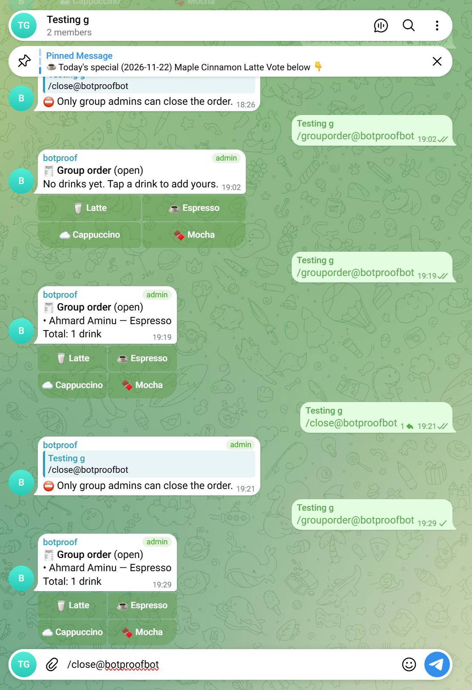
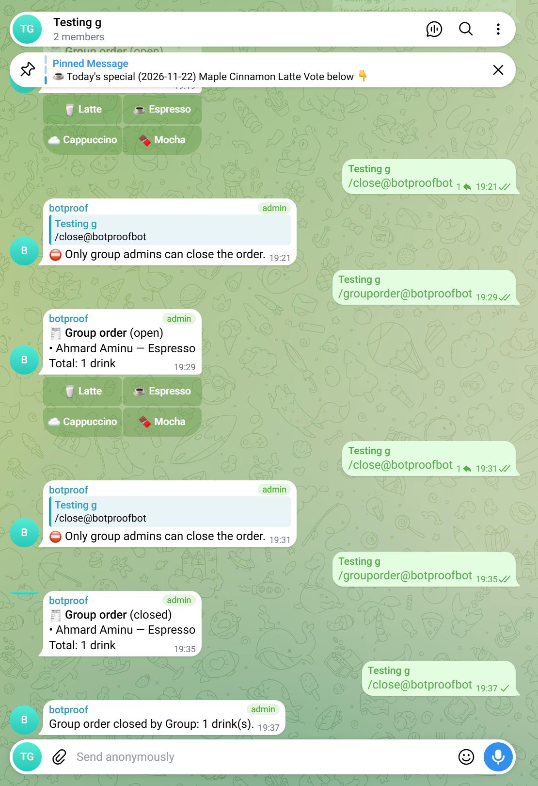
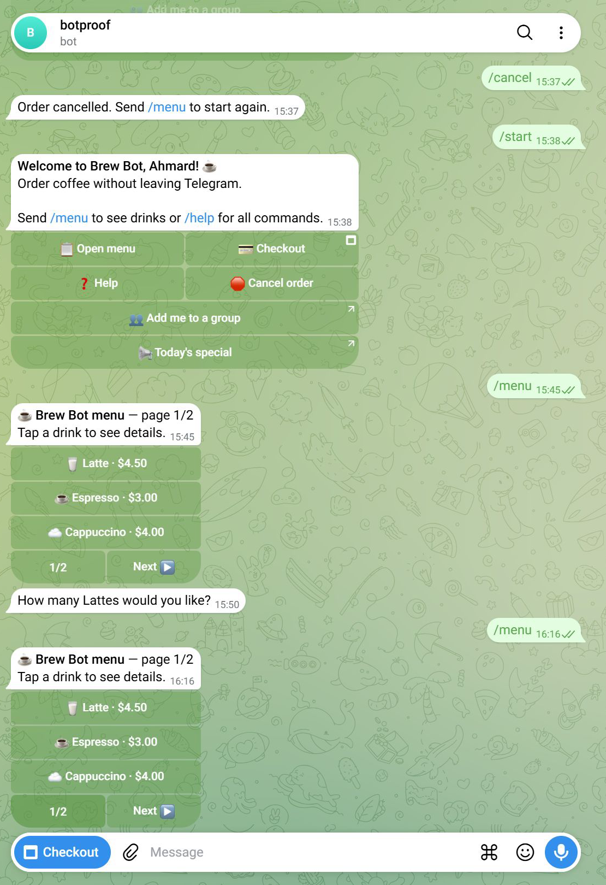
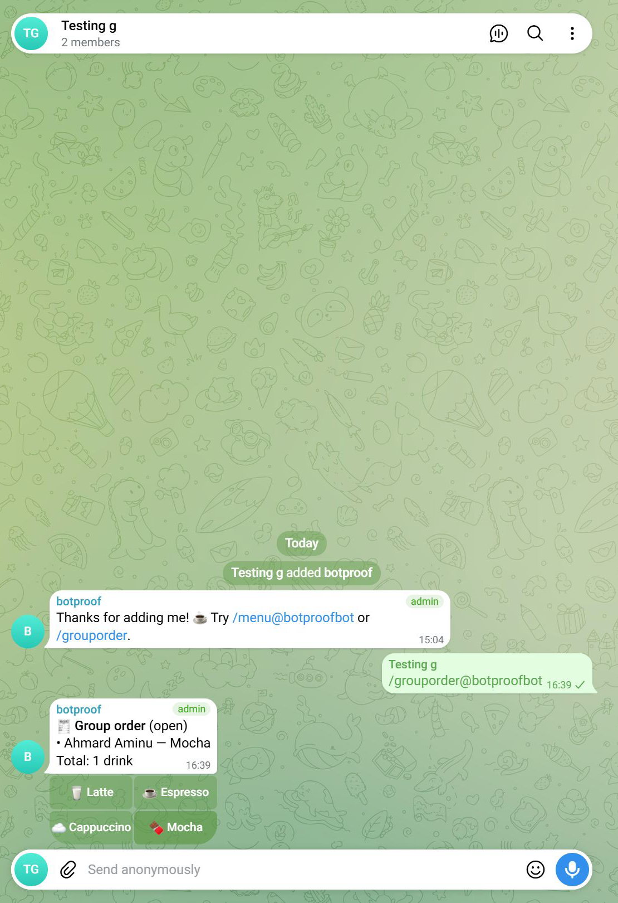
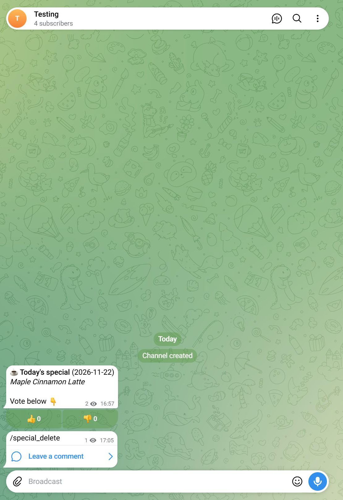

# BotProof

**Your bot works on your laptop. BotProof proves it works in Telegram.**

BotProof runs plain-English test flows against your Telegram bot in the real Telegram Web client, driven by
[Kane CLI](https://www.npmjs.com/package/@testmuai/kane-cli), and hands every failure to your coding agent to fix until the flow passes.

[Demo video](https://youtu.be/mY_bRyfb-SE) · [Demo bot](#demo-bot) · [Evidence packs](https://github.com/ahmardchain/Botproof/releases/tag/evidence-packs) · [Install](#install-and-run)

> **Status (23 Nov 2026):** 11 of 22 flows pass live in real Telegram Web (✅ below), Kane caught 1 real bug in the
> demo bot, and the fix loop fixed it end to end (Kane fail → Claude Code patch → redeploy → Kane pass). Run logs for
> every live run are in [`botproof/runs/`](botproof/runs/); what was verified and how is in [docs/FINDINGS.md](docs/FINDINGS.md).

**▶ [Watch the 3-minute demo](https://youtu.be/mY_bRyfb-SE)**


## What Kane saw (real screenshots)

Taken by Kane in Telegram Web during the runs on 22 Nov (cropped to the chat pane; the test account's chat list is left out).

| The bug: the anonymous owner's `/close` is refused | After Claude's fix: the order closes |
|---|---|
|  |  |

| Inline menu, edited in place | Group order with who tapped | Channel post with vote buttons |
|---|---|---|
|  |  |  |

## The problem

Telegram bots are tested by hand: open Telegram, send `/start`, tap a button, scroll, repeat after every change.
Unit tests mock the Bot API, so they never see what a user sees: a button that does nothing, a message that fails to
render, a keyboard that never goes away, a Mini App that opens blank.

## For judges: start here

Telegram is a third-party login we can't hand over, so every passing flow ships with a **recorded run** instead:
its Kane evidence pack ([release](https://github.com/ahmardchain/Botproof/releases/tag/evidence-packs)), its run log and the demo video (no login needed).

| Do this | You'll see |
|---|---|
| 1. **No login needed:** download a pack from the [evidence-packs release](https://github.com/ahmardchain/Botproof/releases/tag/evidence-packs), then `npx @testmuai/kane-cli evidence serve <pack>.evidence` | Kane's run step by step: screenshots of Telegram Web, what it tapped, what it checked |
| 2. Read one flow, e.g. [`menu_pagination_test.md`](botproof/flows/private/menu_pagination_test.md) | The whole test is plain English |
| 3. Read [a real fix-loop log](#the-closed-loop) | Kane fails a flow → Claude patches the bot → Kane re-runs → pass |
| 4. Open the demo bot in Telegram and send `/start`, then `/menu` | The bot under test, live |
| 5. Run it yourself with your own **test** Telegram account: [Install and run](#install-and-run) | `botproof run --tag smoke` prints PASS/FAIL per flow with an evidence link |

## What BotProof tests

Every row is a `_test.md` flow Kane runs in Telegram Web against the demo bot. ✅ = passed live (run logs in [`botproof/runs/`](botproof/runs/)).

| Area | What is checked | Flow |
|---|---|---|
| Commands & deep links | `/start` welcome renders with a main menu of buttons (menu, checkout, help, cancel, add to group); `/help` lists commands; `t.me/<bot>?start=promo` applies the promo | [start](botproof/flows/private/start_test.md) ✅ · [main_menu](botproof/flows/private/main_menu_test.md) ✅ · [help](botproof/flows/private/help_test.md) · [deeplink](botproof/flows/private/deeplink_test.md) |
| Inline keyboards | next/prev edits the same message; item opens details in place; URL button target; callback alert | [menu_pagination](botproof/flows/private/menu_pagination_test.md) ✅ · [item_details](botproof/flows/private/item_details_test.md) ✅ |
| Reply keyboards | custom keyboard appears, sends "2", one-time keyboard is gone afterwards | [reply_keyboard](botproof/flows/private/reply_keyboard_test.md) |
| Conversations | name → phone, re-asks on bad input, confirm; `/cancel` mid-way | [conversation](botproof/flows/private/conversation_test.md) · [conversation_cancel](botproof/flows/private/conversation_cancel_test.md) ✅ |
| Message rendering | bold, code and link render; no raw `<b>`, `**`, `\` or "message is empty" | [formatting](botproof/flows/private/formatting_test.md) ✅ |
| Media | order photo arrives with the right caption and order number | [conversation](botproof/flows/private/conversation_test.md) |
| Mini App | opens inside Telegram, form + Telegram main button work, data reaches the bot | [miniapp_checkout](botproof/flows/private/miniapp_checkout_test.md) ✅ |
| Menu button | opens the Mini App; paying from it reaches the bot | [menu_button](botproof/flows/private/menu_button_test.md) |
| Groups | `/menu@bot`; group order edited with who tapped; admin `/close`; privacy mode (plain ignored, mention/reply answered); removed and re-added | [group_menu](botproof/flows/group/group_menu_test.md) ✅ · [group_order](botproof/flows/group/group_order_test.md) ✅ · [group_close_admin](botproof/flows/group/group_close_admin_test.md) ✅ · [group_privacy](botproof/flows/group/group_privacy_test.md) · [group_membership](botproof/flows/group/group_membership_test.md) |
| Channels | posts "today's special"; 👍/👎 votes edit the post; bot edits and deletes its post; comments in the discussion group reach the bot | [channel_special_vote](botproof/flows/channel/channel_special_vote_test.md) · [channel_edit_delete](botproof/flows/channel/channel_edit_delete_test.md) ✅ · [channel_comments](botproof/flows/channel/channel_comments_test.md) |
| Stretch | inline mode; stale buttons after cancel | [inline_mode](botproof/flows/stretch/inline_mode_test.md) · [stale_button](botproof/flows/stretch/stale_button_test.md) |

Not built: tests that need a second Telegram account (new-member welcome, non-admin `/close` refusal, "only A can tap A's
buttons"). They are possible with a second Chrome profile but were left out to keep the single-account flows reliable.

## The closed loop

```
 botproof fix
     │
     ▼
 Kane runs the flows in Telegram Web ──── all pass ──► done (log written)
     │ a flow fails
     ▼
 brief for the agent: flow file · failing step · Kane's remark ·
 evidence pack · failure screenshot · bot sources
     │
     ▼
 Claude Code patches the bot ──► edits outside the allowlist are blocked (PreToolUse hook)
     │                            and reverted (git snapshot check)
     ▼
 bot restarted / redeployed ──► Kane re-runs only the failed flows
     │
     └── still failing after 3 attempts ──► stop, escalate to a human with the full log
```

- Editable paths come from `fix.editable` in [`botproof/botproof.config.json`](botproof/botproof.config.json)
  (default: `demo-bot/src/**`, `demo-bot/api/**`, `demo-bot/public/**`). Flow files, `botproof/`, `cli/` and `.claude/`
  are always protected.
- Every attempt is logged to `botproof/runs/<id>/LOG.md`: what failed, Kane's remark, the agent's explanation, the diff, the re-run.
- Two ways to drive it: `botproof fix` runs the agent itself (`claude -p …`); inside Claude Code, `/botproof-fix` uses the
  [skill](.claude/skills/botproof/SKILL.md) and `botproof fix --step`, one attempt per call.

**A real run** ([full log](botproof/runs/fix-2026-11-22T18-25-38/LOG.md), 22 Nov): Kane found that the bot refuses
`/close` from an anonymous group admin. Claude Code patched one condition, BotProof redeployed to Vercel, Kane passed.

| Step | What happened |
|---|---|
| Kane run | `group_close_admin` **failed** at step 3 "Close as the group owner": *"the bot replied that only group admins can close the order"* (374 s, 71.6 credits) |
| Brief → agent | flow, Kane's remark, failure record and screenshot handed to Claude Code |
| Patch (attempt 1) | `demo-bot/src/bot.ts` only; no edits outside the allowlist |
| Redeploy | `vercel deploy --prod` (only `demo-bot/` uploaded) |
| Kane re-run | **passed** (185 s, 20.4 credits) → loop ends, exit 0 |

```diff
   bot.chatType(["group", "supergroup"]).command("close", async (ctx) => {
-    if (!(await isAdmin(ctx, ctx.chat.id, ctx.from.id))) {
+    // An anonymous admin posts as the group itself: from is @GroupAnonymousBot, sender_chat is the group.
+    const anonymousAdmin = ctx.msg.sender_chat?.id === ctx.chat.id;
+    if (!anonymousAdmin && !(await isAdmin(ctx, ctx.chat.id, ctx.from.id))) {
```

The loop also refuses to patch when the bot isn't at fault: in an earlier attempt a Telegram Web tip covered the screen,
Kane's triage blamed the automation, and BotProof stopped without asking the agent (see [FINDINGS](docs/FINDINGS.md)).

## Bugs Kane caught

See [docs/caught.md](docs/caught.md). Only bugs Kane actually caught while building the demo bot are listed.

1. **Anonymous group admins couldn't close a group order**: the bot answered "Only group admins" to the group's own owner.
   Caught by `group_close_admin`, fixed by the loop in [`80593e8`](https://github.com/ahmardchain/Botproof/commit/80593e8).

## Video proof of every run (new)

_Built and tested on 22–23 Nov against a test page driven the way Kane drives Chrome; not yet used on a live Telegram run
(see [Roadmap](#roadmap))._

Kane itself has no video output, but BotProof owns the Chrome that Kane drives, so it can film it:

```bash
node cli/dist/index.js run menu_pagination --record   # films the Telegram Web page while Kane works
node cli/dist/index.js video                          # → botproof/recordings/<time>-<flow>/video.mp4
```

Each video is a title card, Kane's live footage of real Telegram Web (every moment the screen changes plays at real speed; the long pauses while
Kane thinks are cut to under a second), a caption naming the
step Kane is on, a cursor that glides to every spot Kane really clicked (Kane drives Chrome with input events and never
shows a cursor, so BotProof logs each click during `--record` and draws it), and a PASS/FAIL card with Kane's remark: something to attach to a pull request or show a client.
It uses Chrome's own screencast (CDP `Page.startScreencast`) and ffmpeg (`ffmpeg-static` is an optional dependency).

## Demo bot

`demo-bot/` is **Brew Bot**, a coffee-order bot ([grammY](https://grammy.dev)) built to exercise every area above:
paginated inline menu, callback alerts, quantity reply keyboard, a /start main menu of buttons, a validated order conversation, an HTML-formatted
summary and photo, a checkout Mini App (`public/checkout.html`) with Telegram's main button, a menu button, group
orders with admin-only `/close`, and a channel "today's special" with votes and comment replies.

It runs on Vercel: `https://brewbot-botproof.vercel.app` (webhook `/api/webhook`, Mini App `/checkout.html`).
Bot: [@botproofbot](https://t.me/botproofbot) (shown as "Brew Bot"). Test group: [t.me/testingbotproofgroup](https://t.me/testingbotproofgroup). Test channel: [t.me/testingbotproof](https://t.me/testingbotproof).

## Evidence packs

**[Download them from the `evidence-packs` release](https://github.com/ahmardchain/Botproof/releases/tag/evidence-packs).** 17 passing runs, plus `42fbcfdb`, the failing run where
Kane caught the anonymous-admin `/close` bug (the passing re-run after the fix is `28a588a6`). Replay one with
`kane-cli evidence serve <file>.evidence`; the execution IDs match the run logs in [`botproof/runs/`](botproof/runs/).

Cleaned before upload, and each still passes `kane-cli evidence validate`: screenshots are cropped to the chat pane (the
test account's chat list is left out), log lines quoting that chat list are redacted, one long-expired login QR code is
blurred, and every pack was checked for cookies, localStorage, auth keys, tokens, Chrome profile files and the bot token.
Because of the cropping they are not byte-identical to the packs Kane wrote.

## Install and run

Needs Node 20+, Google Chrome, a TestMu AI account, and a **dedicated test Telegram account** (never your personal one).

```bash
npm install -g @testmuai/kane-cli && kane-cli login
```
```bash
git clone https://github.com/ahmardchain/Botproof && cd Botproof && npm install
```
```bash
node cli/dist/index.js init        # checks Chrome + Kane, logs the test account into Telegram Web, asks for bot/group/channel
```
```bash
node cli/dist/index.js run --tag smoke
```
```bash
node cli/dist/index.js fix --tag smoke
```

To test your own bot instead of Brew Bot: point `bot_username` at it in `botproof/botproof.config.json`, write flows in
`botproof/flows/`, and set `fix.editable` to your bot's source folders.

## Roadmap

- **Live Telegram footage in the demo video.** `run --record` + `botproof video` (real-speed footage, pauses cut,
  cursor from Kane's real clicks) is built; next is recording the passing flows with it and cutting those clips into
  the narrated demo. The current demo video uses Kane's screenshots and phone photos of the chat.
- **The remaining flows:** `conversation`, `reply_keyboard`, `menu_button`, `help`, `deeplink`, `stale_button`,
  `channel_special_vote`, `channel_comments`, `group_privacy`, `group_membership`, `inline_mode` (written, not yet passing live).
- **Second test account** for multi-user group tests (new-member welcome, non-admins refused, only A can tap A's buttons).
- **Parallel runs:** one Chrome profile per worker, so a suite doesn't run one flow at a time.
- **CI:** a GitHub Action that runs the smoke flows headless on every push to the bot.

## Limits

- Needs a dedicated test Telegram account and Chrome on the machine running Kane. Its Telegram Web session lives in a
  Chrome profile outside the repo (`~/.botproof/chrome-profile`); never commit or share it. For each flow BotProof starts
  Chrome on a fresh copy of it and attaches Kane over CDP (`--cdp-endpoint`), because when Kane launched Chrome itself it
  sometimes used a blank temp profile or emptied the one it was given ([FINDINGS](docs/FINDINGS.md)).
- Telegram Web K only (`web.telegram.org/k/`); the official apps are not tested.
- Flows run one after another, not in parallel: `kane-cli testrun` gives each worker a fresh Chrome profile, which has no
  Telegram session ([FINDINGS](docs/FINDINGS.md#design-decision-from-the-docs-testmd-run-per-flow-not-testrun)).
- Multi-account group tests are not built.
- Replying to a specific message (Telegram's right-click → Reply) is an optional step in `group_privacy`: in two live
  runs Kane could not operate that menu, so the flow's verdict rests on privacy mode and mentions.
- 11 of the 22 flows have passed live so far; the rest are written but not yet green ([Roadmap](#roadmap)).

## Repo map

```
cli/                 the botproof CLI (TypeScript): init, run (--record), fix, why, video, hook
botproof/flows/      22 plain-English Kane flows (*_test.md)
botproof/botproof.config.json   variables, editable allowlist, agent command
demo-bot/            Brew Bot + Mini App, deployed on Vercel
.claude/             Claude Code skill, /botproof-fix command, edit-guard hook
docs/                FINDINGS (spike), caught bugs, demo script, posts, submission
```

Built for the [KaneCLI Online Hackathon](https://www.kaneclihack.sh) by TestMu AI.
